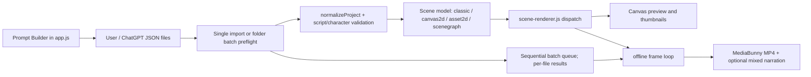

# CP5.0 — Current architecture map

**Checkpoint:** audit and design only. Repository inspection on 2026-11-11. Existing local edits are present; this document describes source as inspected, not a clean-branch release.

## Evidence boundary

The two requested MP4s are present in `C:\Users\nh-lam\Downloads`: `KHTN6_Tap_01_Nguyen-ly-bom-xe-dap_Robot1_VDSL2-9x16.mp4` (9,813,844 bytes) and `KHTN6_Tap_02_Gioi-thieu-ve-Robot_SceneGraph2D-9x16.mp4` (15,704,983 bytes). No `ffmpeg`/`ffprobe` executable or configured video-frame inspection tool was available in this environment, so this audit does not claim frame-level visual observations. The code evidence below is direct; video-specific evaluation remains pending frame access.

## Pipeline as implemented

### Prompt creation

- `src/app.js` builds the Video Script Prompt Builder, appends `buildScriptStructureGuide()` from `src/render/script-prompt-builder.js`, and exposes classic, Canvas 2D, and Scene Graph 2D directions. `src/visual-dsl.js` supplies `visualDslPromptGuide()` and a scientific planner guide. The prompt constrains generated fields to known modes and registered actions; the guide is an instruction string, not a generated v3 machine-readable capability artifact.
- Multi-video prompt creation is implemented in `generateBatchScriptPrompt()` in `src/app.js`. It creates a series prompt with topic, audience, count, per-episode duration, aspect ratio, style, motion mode, individual filenames and ZIP instructions. It requests separate episode JSON files; ZIP creation is delegated to the AI tool, not performed by this application. Asset2D is explicitly excluded from a multi-video series.
- Character-aware prompting is implemented by `src/render/script-prompt-builder.js`: the catalog is built from checksum-verified Published versions, capabilities are passed into character directions, and use mode can be auto/required. `validateCharacterAwareScript()` checks pinned identity/version/type, placement and timing. `src/render/script-character-import.js` resolves references into scene instances.
- Landscape/portrait prompts request `variants.landscape.scenes` and `variants.portrait.scenes`, independently composed while preserving matching narration. Batch validation rejects mismatched scene counts/narration for paired variants.
- Persisted prompt controls use the app preference helpers (localStorage); project content is also saved to browser localStorage. The prompt builder currently favors compact registered illustration/object/action vocabularies and explicit capability constraints. It can still encourage schematic output because the schema offers mostly geometry, labels and registered scene assets rather than broad art-direction or composition primitives.

### Current JSON and scene contracts

- Project normalization is in `src/project.js`: project version 2; up to 100 scenes; `motionMode` values `classic`, `canvas2d`, `asset2d`, `scenegraph`; scenes carry title, duration, narration, voice, visuals, motion, object/asset graph and layers. Optional paired variant scene arrays are normalized separately. Local project storage key is `lam-motion-studio.project.v2` (session-specific suffix where applicable).
- Script import in `src/app.js` maps JSON narration, estimated seconds, voice/subtitle settings, metadata and visual fields into the normalized project. The code accepts scene arrays and wrapper objects. Scene Graph 2D uses `scene_graph.version: 2`; the older Asset Animation graph is version 1 and is a narrow measurement demo. Classic visual objects and Canvas2D actors follow their own existing contracts.
- `src/visual-dsl.js` documents/validates Visual DSL v1 and v2. V2 validates `scene_graph.objects`, `actions`, mechanisms and synchronizations, with limits including 100 scenes, 300 seconds per scene, 180 seconds total, 200 objects and 100 path commands. The current object schema in `src/render/object-scene-schema.js` supports registered shape types (`text`, `label`, `asset`, `group` and geometry types), actions such as move/rotate/scale/fade/draw/follow-path/pulse/show/hide/text/highlight/energize, hierarchical group membership, and mechanism-specific constraints. It is not a general arbitrary SVG/vector document model.
- Registered mechanisms include slider-crank, gear pair and cam-follower with domain-specific validation; these are implemented capabilities, not general physics simulation. `src/render/vector-path.js` samples structured path commands for rendering/motion. Fields described only in guides or prototypes should not be treated as production contract without validation and dispatch evidence.

### Render and export

- `src/render/scene-renderer.js` dispatches classic rendering, Canvas2D prototype rendering, Asset2D demo rendering, and Scene Graph through `renderObjectScene()` in `src/render/object-scene-renderer.js`. Scene graph drawing uses Canvas2D; nodes, human-rig/image-backed characters and Published Sprites are composed with z-index ordering. Classic rendering uses Canvas plus a WebGL background/fallback and built-in illustration/environment drawing.
- Preview calls the same scene renderer functions used by export frame drawing in `src/app.js` (`renderSceneFrameAt` / mode dispatch). This is strong function-level parity, though the canvas dimensions, frame clock, fonts/assets readiness, playback time sampling and export compositing differ; exact pixel parity is not guaranteed by that fact alone.
- Export is sequential per frame through `encodeOfflineFrames()` (`src/render/offline-frame-pipeline.js`) and MediaBunny in `src/app.js`. It writes MP4, optionally mixes per-scene audio using OfflineAudioContext, renders captions into frames, tracks cancellation/progress, and checks muxed video frame count/timestamps/duration plus audio presence/duration. Output dimensions include 1280x720 landscape and 720x1280 portrait. Paired variants use separate scene lists. Enabled outro is added to the scene duration and the combined export is checked against 180 seconds.
- Scene Graph and other supported mode previews use the mode's renderer. Thumbnails also dispatch through these paths. Caption overlay is drawn after the scene graph and is a shared UI/render concern.

### Asset and character boundaries

- Current built-in art comprises Canvas-drawn environments and a finite illustration catalog (`src/render/illustrations.js`, `src/render/scene-renderer.js`), registered Asset2D content, image-backed character parts and Published Sprite PNG frames. There is no general scene image-node asset registry in the current Scene Graph contract. Local asset and character loaders are separate systems.
- `src/render/character-library-storage.js` stores browser drafts, immutable versions, assets and references in IndexedDB database `lam-motion-studio.character-library`; project/session/prompt preferences use localStorage. `data/README.md` states shared Published Character identity/version/assets are in `data/character-library.sqlite`, served through `server.mjs` and `server/character-library-sqlite.mjs`. Current project JSON may contain scene graph character reference metadata; it does not make IndexedDB or SQLite contents part of the DSL.
- Published references are version pinned; character preparation checks readiness and resolves PNG assets before render. Preserve library records and the shared SQLite file during modernization.

### Folder batch workflow (protected)

`runBatchExport()` in `src/app.js` uses File System Access API directory handles. The user selects a source directory and output directory; the app requests needed permissions, lists top-level `.json` files, sorts names, reads and parses all files, then validates each script and checks duplicate/existing output names before rendering. It presents a review list so invalid scripts can be skipped and valid ones started.

For each valid JSON, it resets a working project while preserving brand configuration, imports the script, prepares/generates missing narration voice, renders selected 16:9 and/or 9:16 output sequentially, writes deterministic title-derived filenames, then copies the successful source JSON to `processed-scripts` and removes it from the input directory. On failure it removes outputs already written for that item, rolls back its archived script where possible, logs an item-level error in the UI and continues. Progress identifies file and aspect. The workflow has no explicit resume manifest or retry policy; failed source JSON remains available. Voice generation is through `/api/tts/synthesize`. Per-video output has MP4 checks, but the batch does not currently write a durable batch manifest/log or thumbnails. There is no controlled parallel render pool; work is sequential.

### Startup and data safety

- `package.json`: `npm start` runs `node server.mjs`; tests are Node scripts, but CP5.0 does not change runtime code.
- Shared SQLite is `data/character-library.sqlite`. It was identified by path only; no database opened or queried during this audit. Browser IndexedDB was not opened. This audit did not mutate either store.
- Before audit, `git status --short` showed numerous modified runtime files, untracked character art/data/docs/tests and generated artifacts on branch `codex/visual-dsl-v2.8-natural-human-rig`. All pre-existing changes are outside this CP5.0 documentation patch and must be preserved.

## Implemented / limited / proposed distinction

| Area | Implemented now | Current limitation | CP5.0 proposal |
|---|---|---|---|
| Visual language | Classic, Canvas2D, Asset2D v1, Scene Graph DSL v2 | Mode-specific schemas; no broad art-direction language | New explicit, normalized v3 schema |
| Drawing | Canvas primitives, groups, paths, labels, limited assets | No general reusable symbol library or full style system | Scene nodes + symbols + package-local assets |
| Characters | Published Sprite and rigged references | Existing ordering and asset prep are mode-specific | Unified render-layer adapter retaining version/checksum refs |
| Preview/export | Shared scene renderers, frame-loop export | Different contexts/timing/size can still diverge | One normalized renderer and parity gates |
| Batch | Folder-based JSON to MP4 workflow | Sequential; no durable manifest/resume | Preserve workflow; add v3 adapter and job manifest later |
| Visual benchmark | Two supplied videos are accessible by path | No frame extraction tool available for this audit | Review sampled frames before accepting quality baseline |
